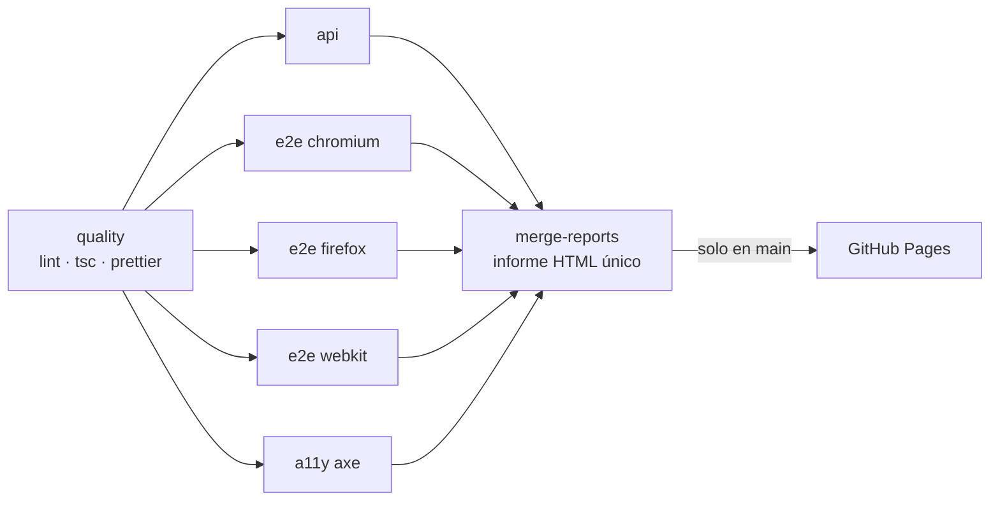

# playwright-qa-portfolio

[](https://github.com/PabloSolano-hub/playwright-qa-portfolio/actions/workflows/ci.yml)
[](https://pablosolano-hub.github.io/playwright-qa-portfolio/)
[](https://github.com/PabloSolano-hub/playwright-qa-portfolio/actions/workflows/performance.yml)

**[Español](#español) · [English](#english)**

---

## Español

Portafolio de QA Automation de **Pablo Enrique Silva Solano**: una suite de pruebas con Playwright + TypeScript sobre [Practice Software Testing (Toolshop)](https://practicesoftwaretesting.com), una tienda de demostración pública con UI y API REST. Está organizada como la suite de un equipo profesional: escenarios de negocio trazables, CI con matriz de navegadores, informe publicado, accesibilidad, rendimiento y una skill de IA integrada en el flujo de QA.

### De un vistazo

|                       |                                                                                                                          |
| --------------------- | ------------------------------------------------------------------------------------------------------------------------ |
| Escenarios de negocio | **34** en español, en [`scenarios/`](scenarios/)                                                                         |
| API                   | **22** tests: autenticación, productos, carrito, favoritos                                                               |
| E2E                   | **7** tests × **3 navegadores** (Chromium, Firefox, WebKit)                                                              |
| Accesibilidad         | **5** auditorías axe (WCAG 2.0/2.1 A + AA)                                                                               |
| Rendimiento           | **1** prueba de carga ligera con k6                                                                                      |
| Informe               | [GitHub Pages](https://pablosolano-hub.github.io/playwright-qa-portfolio/): un único informe HTML que une todos los jobs |

**Stack:** Playwright · TypeScript (strict) · @faker-js/faker · @axe-core/playwright · k6 · ESLint + Prettier · GitHub Actions + Pages.

### Arquitectura

```
.
├── .claude/skills/manual-to-scenario/  # skill de IA: caso manual → escenario + spec (borrador)
├── .github/workflows/                  # ci.yml (suite + informe) · performance.yml (k6)
├── scenarios/                          # escenarios de negocio en español (ESC-*)
├── src/
│   ├── pages/                          # Page Objects (los specs nunca usan selectores)
│   ├── api/                            # clientes de API + retry ante el reinicio horario
│   ├── fixtures/test.ts                # fixtures: page objects, clientes, usuarios, limpieza, axe
│   ├── data/                           # factories con Faker (usuarios, direcciones)
│   └── utils/                          # entorno, accesibilidad, helpers
├── tests/
│   ├── setup/                          # registra un usuario dedicado por ejecución y lo borra al final
│   ├── e2e/                            # tests de interfaz
│   ├── api/                            # tests de API
│   └── a11y/                           # auditorías de accesibilidad
├── performance/                        # script k6
└── playwright.config.ts
```



- Los jobs E2E y a11y corren dentro de la imagen oficial `mcr.microsoft.com/playwright`, con la misma versión fijada en `package.json`.
- Las actions están fijadas por SHA y los permisos son mínimos.
- El CI se ejecuta en cada push y PR a `main`, y una vez al día (06:17 UTC).
- k6 va en un workflow aparte: solo se lanza a mano o cuando cambia el script.

### Cómo ejecutarlo

Requisitos: Node.js 22 (`.nvmrc`) y, para la prueba de carga, [k6](https://grafana.com/docs/k6/latest/set-up/install-k6/).

```bash
npm ci
cp .env.example .env              # URLs y cuenta admin públicas de la demo
npx playwright install --with-deps

npm test                          # toda la suite
npm run test:api                  # solo API
npm run test:e2e                  # E2E en los 3 navegadores
npm run test:a11y                 # accesibilidad
npm run test:headed               # modo visual para depurar
npm run test:perf                 # k6 (fuera de los minutos 58-02 UTC)
npm run report                    # abre el último informe HTML
npm run lint && npm run typecheck
```

### Patrones de calidad

- **Page Object Model:** los selectores viven solo en `src/pages/`. La prioridad es `data-test` > `getByRole` > `getByLabel` > `getByText`.
- **Esperas:** nada de `waitForTimeout`; se usan aserciones web-first. Cuando la UI se re-renderiza de forma asíncrona, se espera la respuesta de la API correspondiente. ESLint lo exige también en `src/`.
- **Datos:**
  - los datos se crean por API, con Faker cuando hace falta; nunca hay ids fijos ni se depende del orden del catálogo;
  - **cada ejecución registra su propio usuario**, y los tests que modifican estado tienen el suyo propio;
  - todo lo creado se borra al terminar, y el estado de cada borrado queda anotado en el informe.
- **Trazabilidad:** cada test empieza por el ID de su escenario (`@ESC-CARRITO-001`), y cada escenario apunta a su spec.
- **Configuración:** por variables de entorno (`BASE_URL`, `API_URL`), con `.env.example` versionado.
- **CI honesto:** 2 reintentos y los tests inestables marcados como _flaky_ en el informe. Nunca se desactiva un test para tener el CI en verde; cada exclusión está documentada.

### Flujo con IA: skill `manual-to-scenario`

[`.claude/skills/manual-to-scenario/`](.claude/skills/manual-to-scenario/SKILL.md) convierte un caso de prueba manual, en cualquier idioma y formato, en:

1. escenarios de negocio en español con el formato del proyecto;
2. un **borrador** de spec que cumple todas las reglas de [`CLAUDE.md`](CLAUDE.md), con los Page Objects y clientes que falten;
3. un **resumen para revisión humana**: supuestos, dudas para el autor del caso, comportamiento de la app descubierto y checklist antes de quitar el `DRAFT`.

La skill **explora la aplicación real antes de escribir un selector**, valida con lint, tsc y la ejecución del spec, y nunca hace commit: la última palabra es del revisor. Sus salvaguardas recogen lo aprendido en este proyecto (cuentas compartidas, Cloudflare, reinicio horario, limpieza de datos).

**Ejemplo real:** [`examples/favoritos/`](.claude/skills/manual-to-scenario/examples/favoritos/).

- El caso manual «CP-27 Favoritos» se dividió en `ESC-FAVORITOS-001/002`.
- Durante la exploración, la skill descubrió que un usuario con favoritos no se puede borrar.
- En la revisión dejó una duda abierta (¿`/account` recibe el challenge en CI?) que el primer run de CI confirmó; las reglas pasaron a cubrirse por API en CI.

### Hallazgos de QA

Encontrados al automatizar, documentados y tratados, no ocultados:

| Hallazgo                                                                                                                                                                                          | Tipo                           | Tratamiento                                                                                                      |
| ------------------------------------------------------------------------------------------------------------------------------------------------------------------------------------------------- | ------------------------------ | ---------------------------------------------------------------------------------------------------------------- |
| El formulario de dirección del checkout **borra lo que el usuario ya escribió**: el perfil se recarga dos veces y reinicia el formulario; la búsqueda de código postal también se envía dos veces | Bug de la app                  | Documentado en [`checkout.md`](scenarios/checkout.md); el Page Object reintenta hasta que los datos se mantienen |
| **3 contraseñas incorrectas bloquean la cuenta** para siempre: un test negativo bloqueó la cuenta pública de cliente                                                                              | Seguridad / diseño de la suite | Nuevo escenario `ESC-API-AUTH-007` con usuario desechable; la suite dejó de usar cuentas compartidas             |
| Sin `Accept: application/json`, los errores de validación vuelven como **302 a HTML** en vez de 422                                                                                               | Comportamiento de la API       | Cabecera en todos los clientes                                                                                   |
| La base de datos de la demo se **reinicia cada hora** (500 y nuevos ids durante ~1 min)                                                                                                           | Entorno                        | Detectado por los timestamps ULID; `retryOnServerError` y k6 rechaza esa ventana                                 |
| **4 defectos de accesibilidad**, uno crítico: botón «mostrar contraseña» sin nombre accesible                                                                                                     | Accesibilidad                  | [`accesibilidad.md`](scenarios/accesibilidad.md); cualquier violación nueva rompe el CI                          |
| API de productos con 3 usuarios virtuales: **0 % de errores**, p95 de 258 a 459 ms                                                                                                                | Rendimiento                    | [`rendimiento.md`](scenarios/rendimiento.md)                                                                     |

### Decisiones y limitaciones

- **Cloudflare en CI:** desde los runners de GitHub, el sitio muestra una verificación anti-bot al cargar páginas de `/account`.
  - `ESC-LOGIN-001` y `ESC-FAVORITOS-001/002` llevan la etiqueta `@cloudflare-ci`: se ejecutan en local en los 3 navegadores y en CI sus reglas se cubren por API.
  - No se intenta eludir la protección.
- **Sitio público compartido:**
  - un usuario con pedidos no se puede borrar (409), así que el usuario de cada ejecución E2E queda en la base de datos con datos ficticios (`example.com`);
  - la carga de k6 es deliberadamente pequeña.
- **Siguiente evolución:** ejecutar Toolshop en una instancia propia (Docker) dentro del CI. Elimina Cloudflare, la dependencia del sitio público y los datos residuales, y devuelve el login de UI al CI.

---

## English

QA Automation portfolio by **Pablo Enrique Silva Solano**: a Playwright + TypeScript suite for [Practice Software Testing (Toolshop)](https://practicesoftwaretesting.com), a public demo shop with a UI and a REST API. It is organised like a professional team's suite: traceable business scenarios, CI with a browser matrix, a published report, accessibility, performance, and an AI skill built into the QA workflow.

### At a glance

|                    |                                                                                                                   |
| ------------------ | ----------------------------------------------------------------------------------------------------------------- |
| Business scenarios | **34**, written in Spanish, in [`scenarios/`](scenarios/)                                                         |
| API                | **22** tests: auth, products, cart, favorites                                                                     |
| E2E                | **7** tests × **3 browsers** (Chromium, Firefox, WebKit)                                                          |
| Accessibility      | **5** axe audits (WCAG 2.0/2.1 A + AA)                                                                            |
| Performance        | **1** low-load k6 check                                                                                           |
| Report             | [GitHub Pages](https://pablosolano-hub.github.io/playwright-qa-portfolio/): one HTML report merged from every job |

**Stack:** Playwright · TypeScript (strict) · @faker-js/faker · @axe-core/playwright · k6 · ESLint + Prettier · GitHub Actions + Pages.

### Architecture

See the folder tree and the CI diagram in the Spanish section above.

- **Folders:** `src/pages` holds the Page Objects; `src/api` the API clients; `src/fixtures/test.ts` the fixtures; `src/data` the Faker factories; `tests/{setup,e2e,api,a11y}` the specs; `performance/` the k6 script; `scenarios/` the Spanish business scenarios.
- **CI flow:** `quality` (lint, tsc, prettier) → `api`, `e2e` ×3 browsers and `a11y` in parallel → `merge-reports` → GitHub Pages, from `main` only.
  - E2E and a11y run in the official Playwright container, pinned to the same version as `package.json`.
  - Actions are pinned by SHA and permissions are minimal.
  - k6 has its own workflow, triggered manually or when the script changes.

### How to run

Requirements: Node.js 22 (`.nvmrc`) and, for the load check, [k6](https://grafana.com/docs/k6/latest/set-up/install-k6/).

```bash
npm ci
cp .env.example .env              # public demo URLs and admin account
npx playwright install --with-deps
npm test                          # whole suite (or test:api, test:e2e, test:a11y, test:headed)
npm run test:perf                 # k6 (outside minutes 58-02 UTC)
npm run report                    # open the latest HTML report
```

### Quality patterns

- **Page Object Model:** selectors live only in `src/pages/`, with the priority `data-test` > role > label > text.
- **Waiting:** no `waitForTimeout`, only web-first assertions. When the UI re-renders asynchronously, the test waits for the matching API response.
- **Data:**
  - data is created through the API (and Faker), never with hard-coded ids;
  - **each run registers its own user**, and tests that mutate state get their own user too;
  - everything created is cleaned up, and each deletion status is annotated in the report.
- **Traceability:** every test title starts with its scenario ID, and every scenario points to its spec.
- **Honest CI:** 2 retries and flaky tests flagged in the report. Tests are never disabled to go green; every exclusion is documented.

### AI workflow: the `manual-to-scenario` skill

[The skill](.claude/skills/manual-to-scenario/SKILL.md) turns a manual test case, in any language and shape, into:

- Spanish business scenarios;
- a **draft** spec that follows every rule in [`CLAUDE.md`](CLAUDE.md);
- a **review summary**: assumptions, open questions, app behaviour found, and a pre-merge checklist.

It explores the real app before writing any selector, validates its output, and never commits. A human reviewer always decides. In the [real example](.claude/skills/manual-to-scenario/examples/favoritos/), the open question it raised (the Cloudflare challenge on `/account` in CI) was confirmed by the first CI run.

### QA findings

- **Checkout address form wipes user input:** the profile loads twice and resets the form, and the postcode lookup is also sent twice. Documented, and the Page Object retries until the input sticks.
- **3 wrong passwords lock an account for good:** a negative test locked the shared public customer account. Fixed with dedicated users per run, and the lockout is now scenario `ESC-API-AUTH-007`.
- **API validation errors:** without `Accept: application/json`, they come back as a **302 to HTML** instead of a 422.
- **Hourly database reset:** for ~1 min the API answers 500 and every id changes. Found through the ULID timestamps of the ids; handled with `retryOnServerError`, and k6 refuses that window.
- **4 accessibility defects**, one critical: the show-password button has no accessible name. Any new violation fails CI.
- **k6:** 0% errors and p95 of 258–459 ms per endpoint, with 3 virtual users.

### Decisions and limitations

- **Cloudflare on CI:** GitHub runners get a bot challenge on `/account` pages.
  - The UI login and favorites tests are tagged `@cloudflare-ci`: they run locally on all 3 browsers, and the same business rules are covered on CI through the API.
  - The suite never tries to get around the protection.
- **Shared public site:**
  - users with orders cannot be deleted (409), so each E2E run leaves one fictitious `example.com` user behind;
  - the k6 load is deliberately small.
- **Next step:** run a self-hosted Toolshop (Docker) inside CI. That removes the Cloudflare challenge, the public-site dependency and the leftover data, and brings the UI login back to CI.
